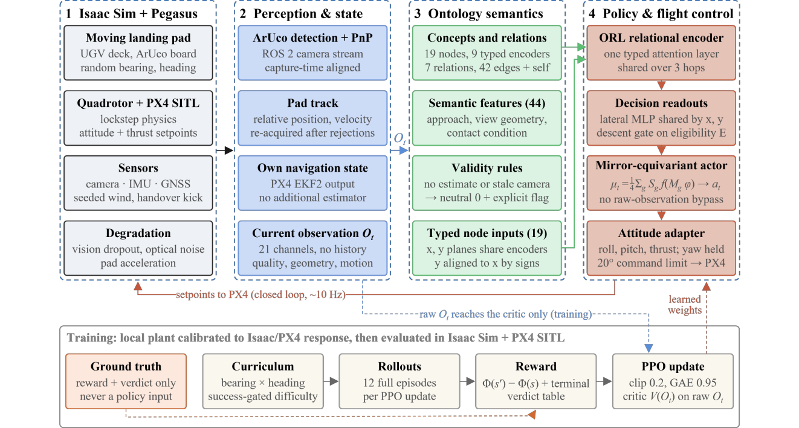
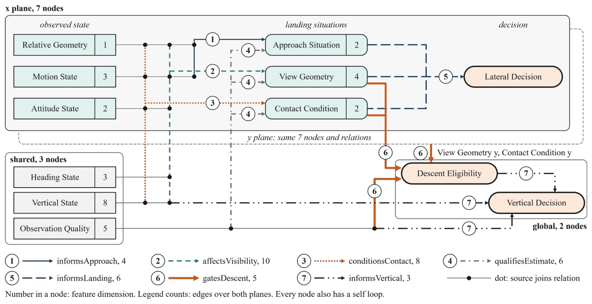
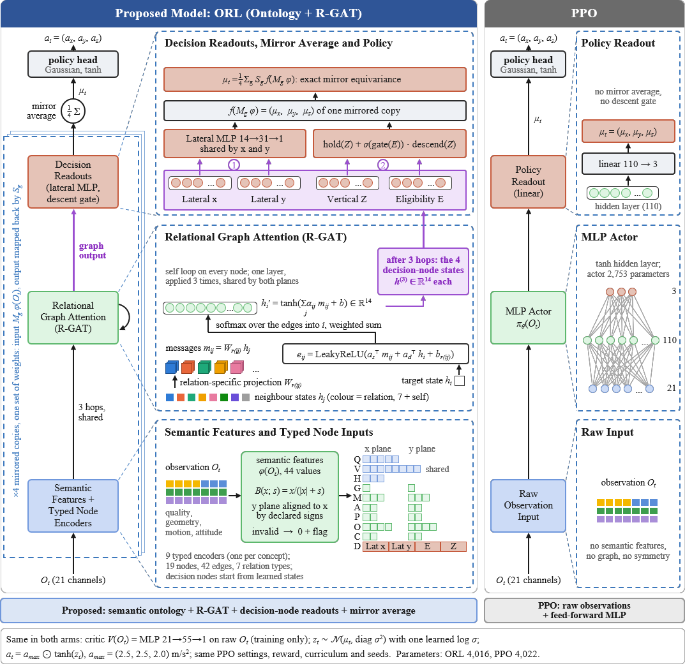
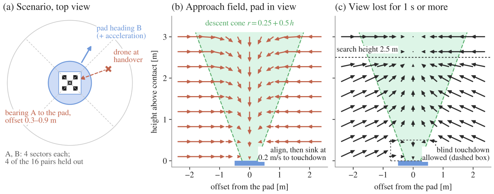
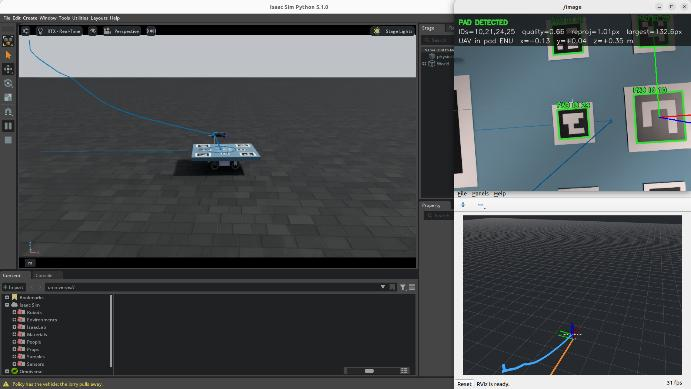
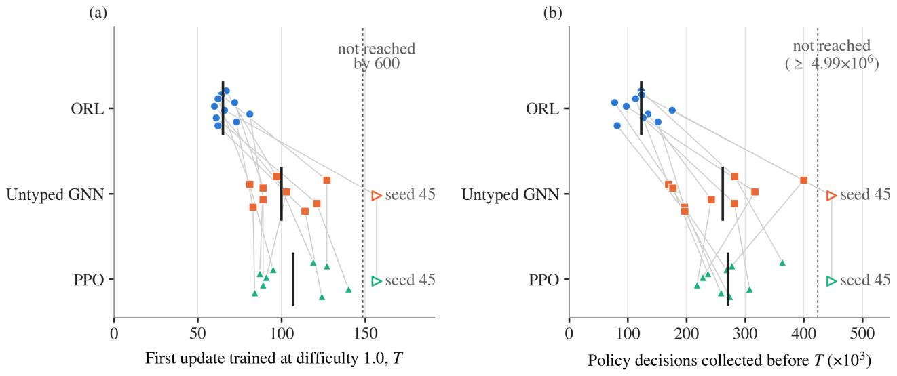
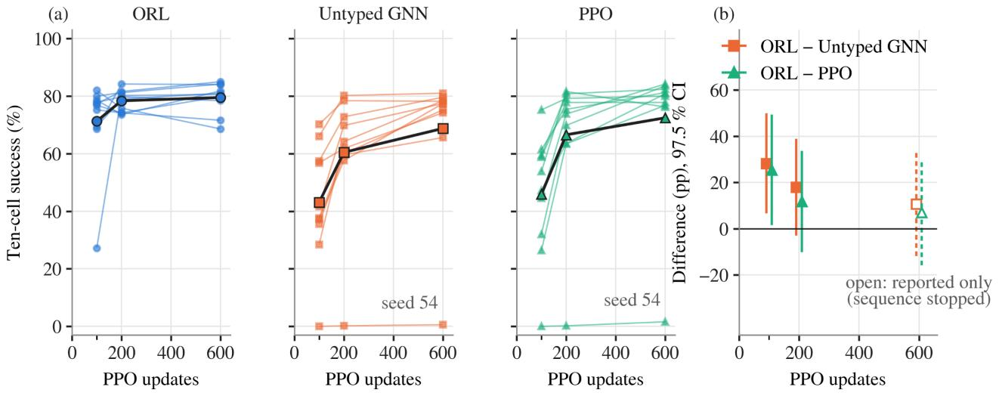
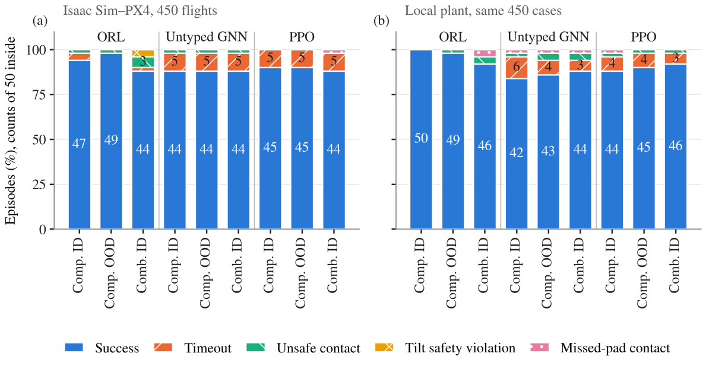
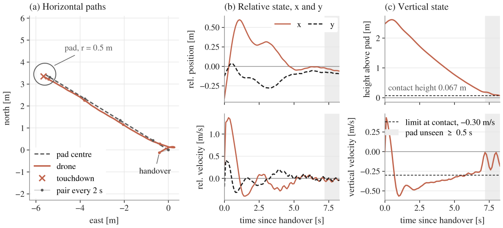

# 이동 플랫폼 UAV 자율 착륙을 위한 온톨로지 구조 강화학습 방법

**An Ontology-Structured Reinforcement Learning Method for Autonomous Landing of UAVs on Moving Platforms**

Jun Suk Kim, Bokyung Choi, Seok Yeong Oh, Yong Hun Kim, Jin Woo Song (세종대학교)

관리자 Jun Suk Kim (김준석) <junsuk55944587@gmail.com> · [Apache License 2.0](LICENSE)

이 저장소는 위 논문의 코드, 방법 정의, 온톨로지 기반 정책 구현이다. 아래 내용은 논문을 옮긴 것이다.

## 초록

- 이동 플랫폼 위 무인항공기(UAV)의 자율 착륙은 상대 운동, 영상 관측 품질, 시야 한계, 접지 안전 조건을 함께 다뤄야 한다.
- 이 논문은 **온톨로지 구조 강화학습(ontology-structured reinforcement learning, ORL)** 을 제안한다.
  - 수작업으로 설계한 착륙 온톨로지를 논리 추론 없이 유형 그래프 스키마로만 쓰고, 이것이 근접 정책 최적화(PPO) actor의 계산 구조를 정하는 심층 강화학습 방법이다.
  - 21차원 관측을 44개 의미 특징으로 바꾸어 19개 노드의 그래프에 배정한다.
  - actor는 개념마다 따로 인코딩하고, 관계 그래프 어텐션으로 메시지를 주고받으며, 결정 노드에서 3축 가속도 명령을 읽는다.
  - 두 수평 착륙 평면은 가중치를 공유하고, 명령은 거울 반사에 대해 평균한다.
- ORL을 비슷한 크기의 untyped-graph 정책, 다층 퍼셉트론(MLP) PPO 정책과 미리 정한 분석 계획에 따라 비교했다. 학습은 축소 차수 시뮬레이터(로컬 플랜트)에서 했다.
- 짝지은 학습 10회 모두에서 ORL이 가장 높은 커리큘럼 난이도에 먼저 도달했다. 중앙값은 65 PPO 업데이트로, 비교 정책은 100과 107이었다.
- 100 업데이트 뒤, 이 시뮬레이터의 평가 조건 10개에 대한 ORL의 평균 착륙 성공률은 71.3 %였다. 비교 정책은 43.1 %, 45.9 %였다. 200 업데이트에서는 차이가 더 이상 확립되지 않았다.
- 600 업데이트 정책을 Isaac Sim–PX4 폐루프에서 정책마다 150회 비행한 성공률은 93.3 %, 88.0 %, 89.3 %였고, 확립된 차이는 없었다.
- 결과는 초기 오프셋 0.3–0.9 m, 높이 2.0–2.5 m의 시험 범위 안에서 구조화된 정책의 초기 커리큘럼 진행이 더 빠르다는 것을 뒷받침한다.
- 개별 구조 요소는 제거 실험(ablation)을 하지 않았고, 최종 성공률의 우위는 주장하지 않는다.

**키워드:** Autonomous landing, Deep reinforcement learning, Learning efficiency, Moving platform, Ontology, Relational graph attention, Structural inductive bias

---

## 1. 서론

- 감시, 정찰, 해양 감시용 UAV는 선박이나 지상 차량에서 운용되는 경우가 많다. 이동하는 운반체 위에 착륙하면 운반체를 멈추지 않고 UAV를 회수할 수 있다 [1–8].
- 고정 패드와 달리 이동 패드는 상대 위치와 속도를 계속 바꾼다. 패드가 시야를 벗어나면 영상 관측이 늦어지거나 끊긴다. 그래도 접지는 속도와 자세 한계를 만족해야 한다.
- 모델 기반 추적과 시각 서보는 플랫폼 운동을 명시적으로 보상한다 [4–6].
  - 강화학습(RL)은 경험에서 착륙 정책을 배우며, 대부분 신경망 정책을 쓰는 심층 RL(DRL)이다 [1–3]. 전용 보상 설계 [7]와 바람을 고려한 궤적 계획 [8]도 연구되었다.
  - 그러나 이 RL 연구들에서 도메인 지식은 관측, 보상, 커리큘럼, 과제 분해를 만들 뿐 정책 구조를 만들지는 않는다.
  - 정책은 어떤 착륙 물리량이 서로 작용하는지 경험에서 스스로 찾아야 한다 [9]. 예를 들어 영상 나이가 시야 특징의 신뢰도를 어떻게 제한하는지이다.
- 원 입력 정책은 착륙 과제의 물리적 상호작용을 잡아내기 어렵다.
  - 그래서 각 노드가 이웃의 정보를 모아 입력 간 상호작용을 학습하는 그래프 신경망이 연구되었고 [9–11], 유형별 변환이 이종 관계를 구분한다 [12].
  - 로봇 학습에서는 이런 그래프가 기술을 조합하고 [13] 여러 로봇을 조정했다 [14]. 그러나 이 그래프 정책도 상황 해석을 처음부터 배워야 한다.
- 도메인 지식은 관측을 구조화하는 센서 온톨로지 [15], sim-to-real 전이에 영향을 주는 입력 표현 [16], 망의 함수 공간을 제한하는 대칭 사전 지식 [17, 18]으로도 들어왔다.
  - 그러나 센서 온톨로지는 데이터를 정리할 뿐이고, 이들 중 어느 것도 착륙 물리량의 상호작용을 정책 안에 담지 않는다.
  - 저자들이 아는 한, 도메인 온톨로지를 정책의 계산 구조로 쓴 UAV 착륙 연구는 없다.
- 이 논문은 착륙에 대한 사전 지식을 수작업 온톨로지의 개념과 유형 관계로 논리 추론 없이 선언하고, 이 그래프 위의 관계 그래프 어텐션망(R-GAT)을 RL 정책으로 최적화하는 ORL을 제안한다.
  - 로봇 RL에서 탐색은 비용이 크다 [19]. 시뮬레이션으로 학습해 챔피언 수준의 드론 레이싱에 이른 정책도 마찬가지다 [20].
  - 상호작용을 스스로 찾아야 하는 정책은, 구조가 그것을 이미 담고 있는 정책보다 더 많은 경험이 필요할 수 있다.
  - 이를 시험하기 위해 퍼텐셜 차 보상 성형 [21]과 커리큘럼 [22]을 모든 정책에 똑같이 적용해, 차이가 정책 구조를 반영하게 했다.
  - 평가는 재현 가능한 시뮬레이션 시험 [23]과 반복 단위·통계 [24]에 대한 권고를 따른다.

**표 1.** 관련 연구와의 비교 (–: 인용한 연구에서 다루지 않음)

| 접근 | 이동 플랫폼 | 학습된 정책 | 그래프 정책 | 온톨로지 정책 |
|---|:---:|:---:|:---:|:---:|
| Model-based [4–6] | ✓ | – | – | – |
| RL landing [1–3, 7] | ✓ | ✓ | – | – |
| RL planning [8] | – | ✓ | – | – |
| Skill graph [13] | – | ✓ | ✓ | – |
| Multi-robot RL [14] | – | ✓ | ✓ | – |
| **ORL (본 연구)** | ✓ | ✓ | ✓ | ✓ |

- 이동 플랫폼은 흔들리는 갑판 [7]을 포함한다. 학습된 정책은 표 형식 Q-learning [3]과 궤적 계획기 [8]를 포함한다.
- 그래프 정책이나 온톨로지 정책에서는 학습된 그래프 연산이나 선언된 개념 관계가 정책 구조를 정한다.

**기여**

- 44개 의미 특징을 공유 상태, 두 수평 착륙 평면, 결정 노드로 된 19개 유형 노드에 배정하는 착륙 온톨로지
- 개념별 인코더, 관계 그래프 어텐션, 평면 가중치 공유, 거울 평균, 하강 게이트로, 선언된 관계를 따라서만 3축 가속도 명령을 계산하는 actor
- 비슷한 크기의 두 비교 정책과의 미리 정한 짝 비교. ORL은 짝 10개 모두에서 가장 높은 커리큘럼 난이도에 먼저 도달했고, 학습 초기에 더 자주 착륙했다.
- 학습 시뮬레이터와 사례별로 짝지은 Isaac Sim–PX4 SITL 폐루프 평가

## 2. 문제 정의와 시스템 구성

### 2.1 이동 플랫폼 착륙

- 쿼드로터가 이동 플랫폼 위에 붙은 마커를 영상으로 추적하며 착륙한다.
- **현재 관측** `O_t ∈ ℝ^21`
  - 상대 위치와 속도, 패드 속도, 기체의 수직 속도·자세·각속도, 영상 갱신 상태와 나이, 항법 유효성과 나이를 담는다.
  - 이력, 적분항, 이전 행동은 없다. 다만 패드 상태는 추적 필터의 출력이다.
  - 기체 상태는 로컬 플랜트에서는 정확한 값이고, Isaac Sim에서는 PX4 EKF2가 준다.
- 시뮬레이터 참값은 보상과 착륙 판정에만 쓴다.
- 정책은 첫 결정 시점인 인계(handover)에서 비행을 넘겨받는다. 이 최종 단계만 연구한다.
- **행동:** 정책은 월드 ENU 좌표계의 3축 가속도 명령을 낸다.

```math
\mathbf{a}_t = [a_x, a_y, a_z]^\mathsf{T},\quad \mathbf{a}_t \in \mathbb{R}^3 \qquad (1)
```

- 명령 가속도는 로컬 플랜트에서 롤, 피치, 추력 명령으로 바뀌고, Isaac Sim에서는 가속도 설정값으로 PX4에 전달된다. 요 각은 정해 둔 기준값으로 유지한다.
- **착륙 판정**
  - 성공: 패드 중심에서 0.5 m 안에 접지하고, `|v_z| ≤ 0.30 m/s`, `‖v_xy‖ ≤ 0.35 m/s`, 기체 기울기 21° 미만
  - 위험 접촉(unsafe contact): 패드 기준 속도 한계를 넘어 접지. 이 한계는 접지 순간에만 적용한다.
  - 기울기 안전 위반(tilt safety violation): 기울기가 21°를 넘음
  - 패드 이탈 접촉(missed-pad contact): 위 반경 밖에서 접지
  - 시간 초과(timeout): 비행이 70 s를 넘음

### 2.2 전체 시스템 파이프라인



*그림 1. 이동 플랫폼 자율 착륙의 시스템 파이프라인: 시뮬레이션, 인식과 상태, 온톨로지 의미, 정책과 비행 제어. 아래 띠는 오프라인 학습 흐름이다.*

1. **시뮬레이션:** Isaac Sim과 Pegasus에서 PX4 SITL 쿼드로터가 지상 차량이 싣고 가는 패드 위를 난다.
2. **인식:** 카메라 영상에서 ArUco 마커를 검출하고, PnP 기반 방법으로 추정한 상대 상태를 기체 항법 정보와 합쳐 현재 관측을 만든다.
3. **온톨로지:** 의미 특징 생성기가 현재 관측을 온톨로지 노드의 입력으로 바꾼다.
4. **정책:** ORL 정책이 가속도 명령을 계산한다. 명령은 20° 명령 기울기 한계를 거쳐 PX4로 간다.

아래 띠는 오프라인 학습 흐름이다(4.1절).

## 3. 온톨로지 구조 강화학습 방법

### 3.1 의미 특징 구성

현재 관측 `O_t`의 물리적 의미를 반영해 44개 의미 특징 `φ_t`를 만든다.

```math
\boldsymbol{\phi}_t = \phi(O_t) \in \mathbb{R}^{44} \qquad (2)
```

- 파생 특징에는 접근 위치·속도 오차, 영상에 투영한 위치와 그 변화율, 영상 경계까지의 여유, 접지 조건 특징이 있다.
- 물리 단위가 다른 특징은 다음 함수로 유계화한다.

```math
B(x; s) = \frac{x}{|x| + s},\quad s > 0 \qquad (3)
```

- 파생 특징은 각자의 유효 조건이 성립할 때만 계산한다.
  - 패드가 카메라 뒤에 있으면 영상 투영 특징을 0으로 두고 명시적 플래그를 켠다.
  - 패드 추정이 있는지는 영상 나이 채널이 알려 준다.

### 3.2 착륙 온톨로지의 개념 계층

온톨로지의 노드는 19개이다(표 2, 그림 2).

- 공유 상태 노드 3개
- 수평 평면마다 개념·결정 노드 7개
- 전역 결정 노드 2개

44개 특징 슬롯은 공유 상태에 16개, 수평 평면마다 14개이다. 두 평면의 같은 개념은 인코더를 공유하고, 입력 부호를 같은 운동 방향 기준에 맞춘다.

**표 2.** 착륙 온톨로지의 개념 노드와 특징 슬롯

| 그룹 | 노드 | 슬롯 | 기능 |
|---|---|---:|---|
| 공유 | ObservationQuality | 5 | 갱신, 나이, 유효성 |
| 공유 | VerticalState | 8 | 높이, 수직 속도, 접지 |
| 공유 | HeadingState | 3 | 요 각과 각속도 |
| 평면 | RelativeGeometry | 1×2 | 상대 위치 |
| 평면 | MotionState | 3×2 | 상대 속도, 패드 속도, 자기 속도 |
| 평면 | AttitudeState | 2×2 | 자세와 각속도 |
| 평면 | ApproachSituation | 2×2 | 접근 오차와 속도 |
| 평면 | ViewGeometry | 4×2 | 영상 위치, 속도, 여유 |
| 평면 | ContactCondition | 2×2 | 접지 위치와 속도 |
| 평면 | LateralDecision | 0 | 수평 제어 |
| 전역 | DescentEligibility | 0 | 하강 게이트 |
| 전역 | VerticalDecision | 0 | 수직 제어 |



*그림 2. 노드 19개와 관계 유형 7개로 된 착륙 온톨로지 그래프. x 평면에 대해 그렸다. y 평면은 같은 노드와 관계를 갖고 모든 가중치를 공유한다. 관계 유형은 선 모양과 번호로 구분한다.*

### 3.3 온톨로지 관계와 그래프 구성

온톨로지에는 의미 관계 유형 7개와 자기 루프가 있다. 관계 간선 42개와 자기 루프 19개가 방향 간선 61개를 이룬다(표 3).

**표 3.** 착륙 온톨로지의 관계 유형과 방향 간선

| 관계 유형 | 연결 | 간선 |
|---|---|---:|
| qualifiesEstimate | Quality → approach, view, contact | 6 |
| informsApproach | Geometry, motion → approach | 4 |
| affectsVisibility | Geometry, motion, attitude, vertical, heading → view | 10 |
| conditionsContact | Geometry, motion, attitude, vertical → contact | 8 |
| informsLanding | Approach, view, contact → lateral decision | 6 |
| gatesDescent | Contact, view, quality → descent eligibility | 5 |
| informsVertical | Vertical, quality, eligibility → vertical decision | 3 |
| Self-loop | 각 노드 → 자기 자신 | 19 |

- 각 수평 결정 노드는 자기 수평 평면과 공유 상태에서 정보를 받는다.
- 수직 결정 노드는 수직 상태, 관측 품질, 하강 적격성 노드에서 정보를 받는다.
- 하강 적격성 노드는 각 수평 평면의 접지·시야 정보와 공유 관측 품질을 모은다.

### 3.4 개념별 인코더와 관계 그래프 어텐션



*그림 3. 제안 ORL(왼쪽)과 MLP PPO 비교 정책(오른쪽)의 actor 구조. 두 정책은 같은 critic, 정책 머리, PPO 설정을 쓴다. 파라미터 4,016개와 4,022개는 공통 critic을 포함한다.*

- 각 개념 노드는 자기에게 배정된 특징 슬롯을 받는다(그림 3).
- 개념 유형 9개마다 선형 인코더가 하나 있고, 출력 차원은 14이다. 두 수평 평면의 같은 개념은 같은 인코더 가중치를 쓴다.
- 관측 입력이 없는 결정 노드는 같은 차원의 학습되는 초기 상태를 갖는다.

```math
h_i^{(0)} = \tanh\!\left(W_{c(i)} x_i + b_{c(i)}\right) \qquad (4)
```

그래프 어텐션 [25]과 관계 그래프 어텐션 [26]을 따라, 각 노드와 자기 루프를 포함한 각 입력 간선에 대해 관계별 메시지 `m_ij`, 어텐션 점수 `e_ij`, 정규화 계수 `α_ij`, 노드 갱신을 다음과 같이 정의한다.

```math
m_{ij}^{(\ell)} = W_{r(i,j)}\, h_j^{(\ell)} \qquad (5)
```

```math
e_{ij}^{(\ell)} = \mathrm{LeakyReLU}\!\left(a_s^\mathsf{T} m_{ij}^{(\ell)} + a_d^\mathsf{T} h_i^{(\ell)} + b_{r(i,j)}\right) \qquad (6)
```

```math
\alpha_{ij}^{(\ell)} = \frac{\exp\!\left(e_{ij}^{(\ell)}\right)}{\sum_{k \in \mathcal{N}(i)} \exp\!\left(e_{ik}^{(\ell)}\right)} \qquad (7)
```

```math
h_i^{(\ell+1)} = \tanh\!\Big(\sum_{j \in \mathcal{N}(i)} \alpha_{ij}^{(\ell)} m_{ij}^{(\ell)} + b\Big) \qquad (8)
```

- 관계 유형마다 파라미터를 공유하는 관계 어텐션 층 하나를 세 번 적용해, 정보가 결정 노드까지 닿게 한다 [10–12].
- 온톨로지 관계는 노드 사이 정보 흐름의 범위를 정하고, 어텐션 연산은 그 정보를 모으는 상대적 가중치를 정한다.

### 3.5 수평 평면 가중치 공유와 거울 등변성

- x와 y 수평 착륙 평면의 대응하는 개념 인코더, 관계 가중치, 수평 결정 판독은 같은 파라미터를 쓴다.
- 수평축의 방향 반사를 나타내는 변환 집합 `G = ℤ2 × ℤ2`에 대해 특징 변환 `M_g`와 행동 부호 복원 `S_g`를 정의하고, 정책 평균을 다음과 같이 계산한다.

```math
\boldsymbol{\mu}_t = \frac{1}{4} \sum_{g \in G} S_g\, f_\theta\!\left(M_g \boldsymbol{\phi}_t\right) \qquad (9)
```

- 같은 정책을 각 반사에 적용하고, 행동을 원래 축으로 되돌려 평균한다. 이로써 정책 출력에 수평 거울 등변성이 들어간다 [17]. 이는 RL의 대칭 사전 지식과도 맞는다 [18].
- 영상 경계 여유처럼 방향에 따라 달라지는 특징은 선언된 반사 규칙으로 변환한다.
- 이 등변성은 구성상 정확하다. 반면 평면 가중치 공유는 근사일 뿐이다. 640×480 영상과 0이 아닌 요 각이 두 평면의 동등성을 깨기 때문이다.

### 3.6 결정 노드 기반 수평·수직 제어

수평 명령은 각 평면의 LateralDecision 노드에서 공통 판독으로 나온다.

```math
\mu_x = f_\text{lat}\!\left(h_{\text{Lat}_x}^{(3)}\right),\quad \mu_y = f_\text{lat}\!\left(h_{\text{Lat}_y}^{(3)}\right) \qquad (10)
```

수직 명령은 VerticalDecision과 DescentEligibility의 정보를 합친다.

```math
\mu_z = f_\text{hold}\!\left(h_Z^{(3)}\right) + \sigma\!\left(f_\text{gate}\!\left(h_E^{(3)}\right)\right) f_\text{descend}\!\left(h_Z^{(3)}\right) \qquad (11)
```

- 하강 게이트는 접지 조건, 시야, 관측 품질에 대한 학습되는 함수이다.
- 잠재 행동은 정규분포에서 뽑고 tanh 변환으로 제한한다.

```math
z_t \sim \mathcal{N}\!\left(\boldsymbol{\mu}_t, \mathrm{diag}(\sigma_a^2)\right),\quad \mathbf{a}_t = \mathbf{a}_\text{max} \odot \tanh(z_t) \qquad (12)
```

```math
\mathbf{a}_\text{max} = (2.5,\ 2.5,\ 2.0)\ \text{m/s}^2 \qquad (13)
```

- critic은 현재 원 관측 `O_t`를 입력으로 받는 가치 함수 `V_ψ(O_t)`이며, PPO 학습에 쓴다 [27].

## 4. 강화학습과 실험 설계

### 4.1 보상 함수와 PPO 학습

목표 접근 속도장 `v_des`를 써서 상대 기하와 운동 오차에 대한 퍼텐셜 함수를 정의한다.

```math
\Phi(s) = -\left(2\,\|(e, h)\| + 4\,\|v - v_\text{des}(e, h, \tau_\text{vis})\|\right) \qquad (14)
```

```math
r_t = \Phi(s_{t+1}) - \Phi(s_t) - \left(0.3 + 0.5\,\mathrm{mean}(u_t^2)\right)\Delta t - 20\,\kappa_t^2\,\Delta t + R_\text{term} \qquad (15)
```

- `u_t = a_t / a_max`이다. `κ_t`는 10°를 넘는 기울기를 11°로 정규화한 값이다.
- 식 (14)의 `e`, `h`, `v`, `τ_vis`는 수평 오차, 높이, 패드 기준 속도, 영상 나이이다.
- 종료 보상 `R_term`은 성공 +25, 시간 초과 −12, 그 밖은 −40이다.
- **PPO:** 업데이트마다 완결 에피소드 12개, 클립 계수 0.2, 8 에폭, GAE 계수 0.95를 쓴다. KL 발산이 0.03을 넘는 actor 단계는 거부한다.
- 할인은 실제 전이 시간을 쓰고, 시간 상수는 70 s이다.
- 식 (15)의 성형 항은 할인되지 않는다. 그래서 퍼텐셜 기반 성형의 정책 불변성 [21]은 주장하지 않는다.
- **커리큘럼:** 최근 다섯 업데이트의 평균 학습 성공률이 0.5에 이르면 학습 난이도 `d`를 0에서 1까지 0.1씩 올린다 [22].
- **평가 조건:** 모든 평가는 `d = 1`이다.
  - 초기 수평 오프셋 0.3–0.9 m, 인계 높이 2.0–2.5 m
  - 패드는 0.3–0.8 m/s에서 정해진 진행 방향을 따라 순항 속도 0.4–1.6 m/s까지 가속한다.
  - 접근 방위와 패드 진행 방향은 각각 90° 구역 네 개에서 뽑는다. 구역 쌍 16개 중 12개는 학습에 쓰고 4개는 제외한다(그림 4).
  - 영상 끊김과 외란도 적용한다.



*그림 4. 접근 시나리오와 목표 속도장: (a) 인계 시점의 시나리오 추출, (b) 패드가 시야에 있을 때의 목표 드론−패드 상대 속도, (c) 시야를 1 s 잃은 뒤의 속도장(0.5 s부터 상승을 섞는다).*

### 4.2 시뮬레이션과 비교 정책



*그림 5. Isaac Sim–PX4 시연 비행: 시뮬레이터(왼쪽), ArUco 마커가 검출된 기체 카메라(오른쪽 위), RViz 궤적(오른쪽 아래).*

- **비행 환경:** Isaac Sim 5.1.0과 Pegasus Simulator, PX4 v1.14.3 SITL, ROS 2 Humble(그림 5)
  - 하방 카메라는 640×480 화소, 수평 화각 약 90°이다.
  - 패드는 ArUco 마커 17개로 된 보드로 추정한다.
  - 물리, 렌더링, 정책 결정은 각각 250 Hz, 30 Hz, 약 10 Hz로 돈다.
- **로컬 플랜트:** 학습과 평가 셀 10개는 자세, 추력, 지연, 영상 검출 모델을 가진 축소 차수 로컬 플랜트를 쓴다.
  - 모델 파라미터는 Isaac Sim–PX4 비행 기록에서 정했다. 식별 데이터는 보관하지 않아 적합도는 보고하지 않는다.
  - Isaac Sim과 달리 공기 항력이 없고, EKF2 추정 대신 정확한 기체 상태를 쓴다.
- **비교 정책**
  - **MLP PPO**(그림의 PPO): 원 관측을 받는 21–110–3 다층 퍼셉트론(MLP) actor(그림 3)
  - **untyped-graph PPO**(그림의 Untyped GNN): 원 관측과, 관계 유형을 합친 더 작은 그래프의 판독을 함께 받는 actor
    - 평면 가중치 공유, 거울 평균, 하강 게이트도 없다. 그래서 관계 유형만 뺀 제거 실험이 아니다.
  - 학습 파라미터 수는 공통 critic을 포함해 ORL 4,016개, untyped-graph PPO 4,020개, MLP PPO 4,022개이다.
  - 세 정책은 보상, 커리큘럼, 학습 예산, 가치 함수 설계, 평가 환경을 공유한다.

### 4.3 평가 시나리오

표 4의 다섯 범주는 각각 명목 조건과 확장 조건을 갖고, 로컬 플랜트의 평가 셀 10개를 이룬다.

**표 4.** 평가 시나리오

| 범주 | 명목 평가 | 확장 평가 |
|---|---|---|
| 접근 방향 | 학습한 방향 조합 | 제외한 방향 조합 |
| 이동 플랫폼 | 명목 플랫폼 운동 | 패드 가속 0.6–0.9 m/s² |
| 시야 | 관측 끊김 1–3 s | 관측 끊김 3–4 s |
| 영상 잡음 | 명목 잡음 수준 | 광학 잡음 5배 |
| 복합 | 명목 운동, 1–3 s 끊김 | 가속, 3–4 s 끊김, 잡음 5배 |

- 영상 잡음은 로컬 플랜트에만 모델링하고 폐루프 비행에는 넣지 않는다.
- **학습 속도:** `T`는 `d = 1`로 학습한 첫 PPO 업데이트의 번호이다. 한 업데이트는 길이가 다른 에피소드 12개를 쓰며, 전이 수가 고정되지 않는다.
- **착륙 성능:** 성공률이다. 폐루프 비행에서는 종료 판정도 보고한다.

### 4.4 같은 예산 평가와 폐루프 평가

- ORL과 두 비교 정책을 학습 시드 10개(50–59)로 각각 600 업데이트 학습한다. 학습 속도 비교의 시드(40–49)와 겹치지 않는다.
- 100, 200, 600 업데이트 직후의 정책을 로컬 플랜트의 셀 10개에서 셀마다 50 에피소드로 평가한다.
- 모델의 착륙 성능은 셀별 성공률의 산술평균이다.

```math
J_\text{landing} = \frac{1}{10} \sum_{c=1}^{10} \frac{N_{\text{success},c}}{N_{\text{episode},c}} \qquad (16)
```

- 정책 간 차이는 짝지은 학습 반복에 대해 계산한다. 두 비교 정책과의 비교에는 Bonferroni 보정한 양측 97.5 % 신뢰구간을 쓴다.
- 학습 예산은 100, 200, 600 업데이트 순서로 검정하고, 구간이 0을 포함하는 첫 예산에서 멈춘다.
- 세 비교는 외부 등록소가 아니라 프로젝트 안에 둔 계획 파일을 따른다. 그 밖의 분석은 사후(post hoc)로 표시한다.
- **Isaac Sim–PX4 평가:** 정책마다 600 업데이트 모델 10개를 15사례씩 결정론적으로 비행한다.
  - 학습한 방향 조합, 제외한 방향 조합, 복합 관측 조건에서 각각 5사례이다. Isaac Sim에서는 이 세 조건만 비행했다.
  - 두 환경을 비교하기 위해 450사례 모두를 로컬 플랜트로도 비행한다.

## 5. 실험 결과

### 5.1 학습 효율



*그림 6. 짝지은 시드 10개의 학습 속도: (a) 난이도 1.0으로 학습한 첫 업데이트 `T`, (b) `T` 전에 모은 정책 결정 수(사후 분석). 막대: 중앙값. 빈 삼각형: 600 업데이트 안에 난이도 1.0에 도달하지 못한 시드 45의 비교 정책.*

- 학습 시드 10개(40–49)의 미리 정한 비교에서, 짝지은 반복 10개 모두에서 ORL이 두 비교 정책보다 먼저 가장 높은 학습 난이도에 도달했다(그림 6(a)).
  - 정확한 양측 부호검정은 p = 0.002이며, 기술적으로만 보고한다.

| | ORL | untyped-graph PPO | MLP PPO |
|---|---:|---:|---:|
| `T` 중앙값 (업데이트) | **65** | 100 | 107 |

- **시드 45:** 두 비교 정책은 600 업데이트 내내 가장 낮은 난이도에 머물렀다. 이 중도절단 실행은 미리 정한 규칙에 따라 600 업데이트로 셌으며, 관측값이 아니다.

| ORL / 비교 | `T` 비의 기하평균 | Bonferroni 97.5 % 구간 | 시드 45 제외 (사후) | 정책 결정 수 기준 (사후) |
|---|---:|---:|---:|---:|
| untyped-graph PPO | **0.56** | [0.33, 0.94] | 0.67 [0.54, 0.83] | 0.36 [0.17, 0.74] |
| MLP PPO | **0.53** | [0.32, 0.90] | 0.64 [0.50, 0.81] | 0.33 [0.16, 0.65] |

- 비는 반복별 `T(ORL)/T(비교)`의 기하평균이고, 구간은 로그 척도의 짝지은 t 구간이다.
- 두 구간의 상한은 모두 1보다 작다. 다만 짝의 방향과 달리 구간은 중도절단 실행에 준 값에 따라 달라진다.
- 마지막 열은 `T` 전에 모은 정책 결정, 곧 환경 전이의 수로 센 비이다(그림 6(b)).

### 5.2 같은 학습 예산에서의 착륙 성공률



*그림 7. 같은 학습 예산에서의 성공률: (a) 시드별 셀 10개 성공률과 평균, (b) ORL에서 각 비교 정책을 뺀 차이와 97.5 % 구간(빈 기호: 검정하지 않음). 시드 54: 비교 정책이 가장 낮은 난이도에 머물렀다.*

셀 10개 평균 성공률

| 정책 | 100 업데이트 | 200 업데이트 | 600 업데이트 |
|---|---:|---:|---:|
| **ORL** | **71.3 %** | **78.4 %** | **79.5 %** |
| untyped-graph PPO | 43.1 % | 60.5 % | 68.8 % |
| MLP PPO | 45.9 % | 66.6 % | 72.5 % |

ORL − 비교 (퍼센트포인트, 97.5 % 구간)

| 비교 | 100 업데이트 | 200 업데이트 | 600 업데이트 |
|---|---:|---:|---:|
| untyped-graph PPO | **+28.2** [+7.1, +49.4] | +17.9 [−2.5, +38.4] | +10.7 (검정하지 않음) |
| MLP PPO | **+25.4** [+2.0, +48.9] | +11.8 [−9.6, +33.2] | +7.0 (검정하지 않음) |

- 100 업데이트에서는 두 구간 모두 0을 포함하지 않는다.
- 200 업데이트의 차이는 확립되지 않아 미리 정한 순서 검정이 멈췄다. 600 업데이트의 차이는 검정 없이 보고한다.
- **시드 54:** 앞의 시드 45와 다른 실행인데, 여기서도 두 비교 정책이 가장 낮은 난이도에 머물렀다.
  - 이 시드를 사후로 빼면 100 업데이트의 차이는 +22.5 [+5.9, +39.0], +19.4 [0.0, +38.7]이다.
  - 600 업데이트의 평균은 79.0 %, 76.3 %, 80.3 %가 된다.
- 따라서 ORL의 이점은 학습 초기에만 뒷받침된다.
- **복합 확장 셀:** 세 정책 모두 모든 예산에서 에피소드의 10 % 미만을 착륙했다(600 업데이트에서 9.2 %, 4.8 %, 5.6 %). 실패는 대부분 패드 이탈 접촉과 기울기 위반이었다.

### 5.3 Isaac Sim–PX4 폐루프 착륙 성능



*그림 8. 600 업데이트 정책의 판정(막대마다 50사례): (a) Isaac Sim–PX4 폐루프 비행, (b) 같은 450사례의 로컬 플랜트 비행. Comp. ID/OOD: 학습한/제외한 방향 조합, Comb. ID: 복합 조건.*

| 정책 | 학습한 방향 | 제외한 방향 | 복합 조건 | 전체 |
|---|---:|---:|---:|---:|
| **ORL** | 94 % | 98 % | 88 % | **93.3 %** (140/150) |
| untyped-graph PPO | 88 % | 88 % | 88 % | 88.0 % (132/150) |
| MLP PPO | 90 % | 90 % | 88 % | 89.3 % (134/150) |

- ORL의 제외한 방향과 학습한 방향 사이 차이는 두 비행이며, 로컬 플랜트에서는 반대이다.

| ORL − 비교 | 평균 차이 | 97.5 % 구간 |
|---|---:|---:|
| untyped-graph PPO | +5.3 pp | [−25.0, +35.6] |
| MLP PPO | +4.0 pp | [−26.2, +34.2] |

- 두 구간 모두 0을 포함하므로 차이는 확립되지 않았다.
- **ORL의 실패 10건:** 시간 초과 3, 위험 접촉 5, 기울기 안전 위반 2
  - 안전 관련 종료 7건 중 5건은 한 모델(학습 시드 57)에서 나왔다. 이 모델은 같은 15사례를 로컬 플랜트에서 14번, Isaac Sim에서 10번 착륙했다.
- **비교 정책의 실패:** 대부분 시드 54 모델의 시간 초과 각 15건이다.
  - 이 시드를 사후로 빼면 ORL은 135회 중 125회, untyped-graph PPO는 132회, MLP PPO는 134회 착륙했다.
- **로컬 플랜트와의 짝:** 같은 사례에서 ORL은 로컬 플랜트 비행의 96.7 %를 착륙했다.
  - 짝지은 450사례 중 397사례는 두 환경 모두 성공, 9사례는 Isaac에서만 성공, 12사례는 로컬 플랜트에서만 성공, 32사례는 둘 다 실패였다.
  - 성공·실패 판정은 450사례 중 429사례(95.3 %)에서 일치했다. 이 일치는 판정에 대한 것이고 궤적에 대한 것이 아니다.
  - 공통 실패 32사례 중 29사례는 시드 54의 비교 정책이다.



*그림 9. 로컬 플랜트에서 재생한 ORL 착륙 성공 사례 하나(시드 59, Isaac Sim–PX4에서도 성공): (a) 드론과 패드의 수평 경로, (b) 상대 위치와 속도, (c) 높이와 수직 속도.*

- Isaac Sim 비행의 시계열은 저장하지 않았으므로, 성공 사례 하나를 로컬 플랜트에서 재생해 그렸다.
- 인계 후 8.28 s에 패드 기준 수직 속도 0.18 m/s로 접지했다. 같은 사례는 Isaac Sim에서 6.76 s에 성공했다.
- 명령 가속도와 자세는 기록하지 않아, 보이는 과도 응답은 진단할 수 없다.

## 6. 논의

- 원 관측에 그래프 판독을 이어 붙이는 구조와 달리, ORL은 다음 세 가지를 한다.
  - 관측에서 행동으로 가는 경로를 온톨로지의 개념별 입력 범위와 관계로 제한한다.
  - 두 수평 착륙 평면이 가중치를 공유한다.
  - 평균으로 거울 등변성을 강제한다.
- 이 귀납 편향으로 ORL은 짝 10개 모두에서 가장 높은 난이도에 먼저 도달했고, 100 업데이트 예산에서 더 자주 착륙했다. 이는 초기 커리큘럼 진행이 더 빠르다는 것을 뒷받침한다.
- **이점은 학습 초기에 한정된다.**
  - 차이는 200 업데이트에서 확립되지 않았고, 600 업데이트에서는 검정하지 않았다.
  - 폐루프에서도 확립되지 않았다. 폐루프에서는 학습에 성공한 비교 정책이 ORL만큼 또는 그보다 자주 착륙했다.
- Isaac Sim에서 ORL의 안전 관련 종료 7건은 대부분 한 모델에서 나왔으므로, 모델 간 편차를 분석해야 한다.
- 구조적 편향을 한꺼번에 넣었고 untyped-graph 비교 정책은 ORL과 여러 요소에서 다르다. 그래서 유형 관계를 포함한 각 편향의 기여는 식별되지 않았다.
- 고전 제어기와는 비교하지 않았다. 로컬 플랜트는 시스템 식별로 검증하지 않았고, 판정 규칙은 안전 보장이 아니다.
- 복합 확장 조건에서는 세 정책 모두 에피소드의 10 % 미만을 착륙했다.
- **향후 과제:** 편향별 제거 실험, 같은 전이 수에서의 비교, 학습 시드 확대, 궤적 기록

## 7. 결론

- 이 연구는 착륙 온톨로지의 개념과 관계를, 이동 플랫폼 UAV 착륙용 PPO 정책의 계산 구조에 적용하는 ORL을 제안했다.
- 미리 정한 계획에서 ORL은 짝 10개 모두에서 가장 높은 학습 난이도에 먼저 도달했다. 중앙값은 65 업데이트로, untyped-graph PPO와 MLP PPO는 100과 107이었다.
- 100 업데이트 뒤 로컬 착륙 성공률은 71.3 %로, 비교 정책보다 28.2와 25.4 퍼센트포인트 높았다. 더 큰 예산에서는 차이가 확립되지 않았다.
- Isaac Sim–PX4 폐루프에서 600 업데이트 정책은 93.3 %(ORL), 88.0 %, 89.3 %의 비행에서 착륙했고, 이번에도 확립된 차이는 없었다.
- 구조화된 정책은 시뮬레이션에서 학습 초기에 더 빨리 진행했다. 최종 성공률의 우위와 각 구조 요소의 기여는 입증되지 않았다.

---

## 코드와 자료

논문의 Data Availability 문단을 그대로 옮긴다.

> The result logs and analysis plan files are kept by the authors and are not in the public repository. The code, method definition, and ontology-based policy implementation are available at https://github.com/junsuk123/ONTOLOGY-STRUCTURED-REINFORCEMENT-LEARNING.

- 논문 ↔ 코드 대응과 실행 방법은 [구현 안내](Ontology_RGAT_UAV_RL_ISAAC_PX4/README.md)에 있다.
- 그림 목록: [docs/figures/README.md](docs/figures/README.md) · 참고문헌: [REFERENCES.md](Ontology_RGAT_UAV_RL_ISAAC_PX4/docs/REFERENCES.md)

## 사사

논문의 Funding 문단을 그대로 옮긴다.

> This work was supported by Institute of Information & communications Technology Planning & Evaluation (IITP) under the Artificial Intelligence Innovation Human Resources Development (IITP-2026-25549817) grant funded by the Korea government (MSIT). This work was supported by Institute for Information & communications Technology Promotion (IITP) grant funded by the Korea government (MSIT) (RS-2026-25540611, Development of Intelligent Data Fusion and Virtualization Technologies for Timely and Dynamic Provision of Mission-Tailored Data for Military Operations).

## 저작권과 관리자

- **저작권:** Copyright © 2026 Jun Suk Kim (김준석). 이 저장소의 코드, 설정, 문서, 그림의 저작권은 저자에게 있다.
- **라이선스:** [Apache License 2.0](LICENSE). 재배포할 때는 [NOTICE](NOTICE)를 함께 둔다.
- **관리자:** Jun Suk Kim (김준석), <junsuk55944587@gmail.com>
- **인용:** 저장소 인용 정보는 [CITATION.cff](CITATION.cff)에 있다.
- **제3자 저작물:**
  - 관계 그래프 어텐션 층의 개념과 그 출처: [NOTICE](NOTICE)
  - UGV 모델(AgileX Ranger Mini 3.0, BSD): `Ontology_RGAT_UAV_RL_ISAAC_PX4/assets/ranger_mini_v3/`
  - Isaac Sim, Pegasus Simulator, PX4-Autopilot, Micro XRCE-DDS Agent, `px4_msgs`는 이 저장소에 포함하지 않는 외부 의존성이며 각자의 라이선스를 따른다.
